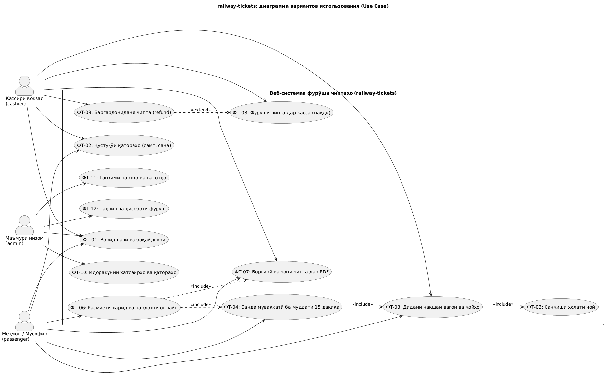
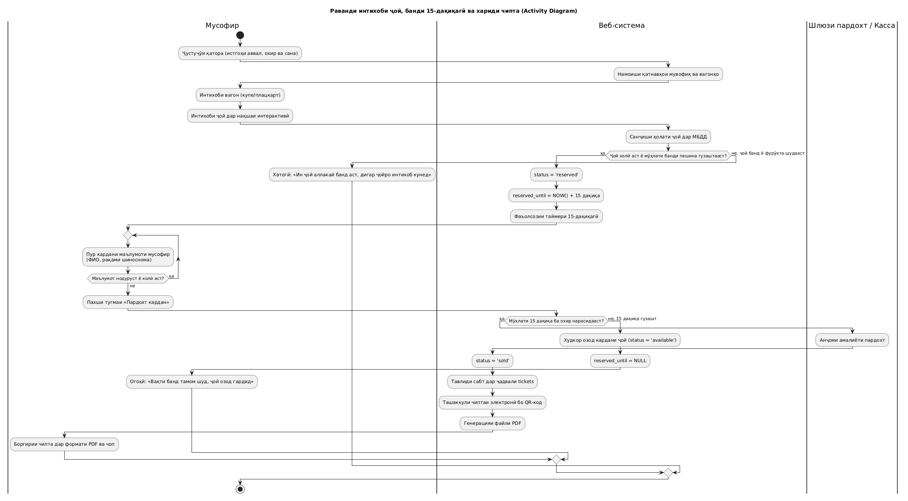
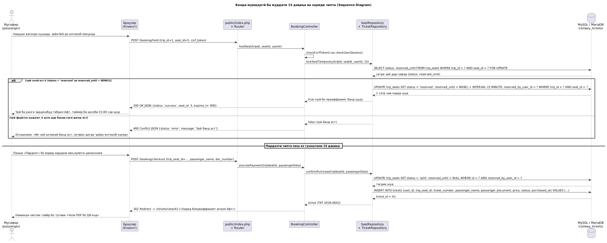
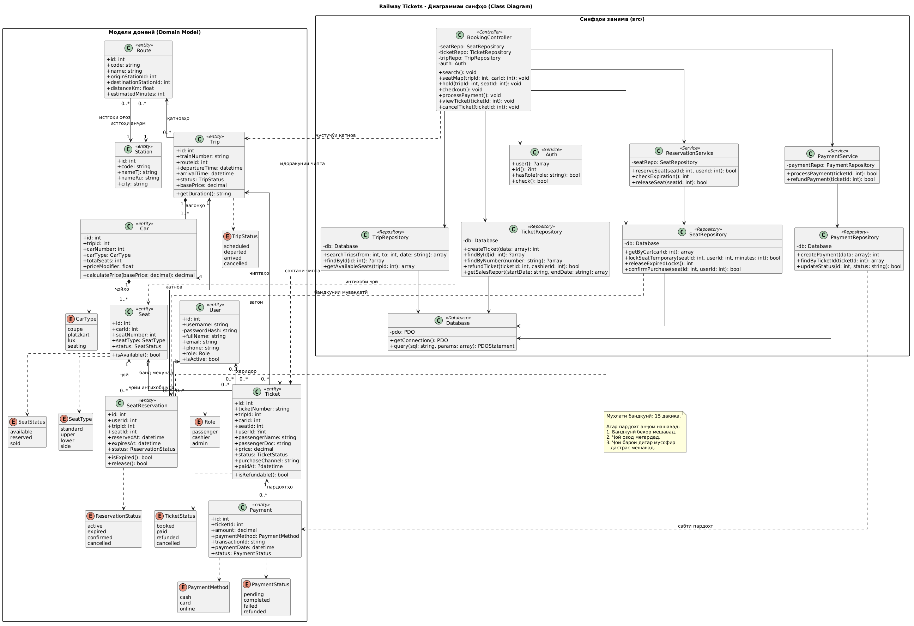
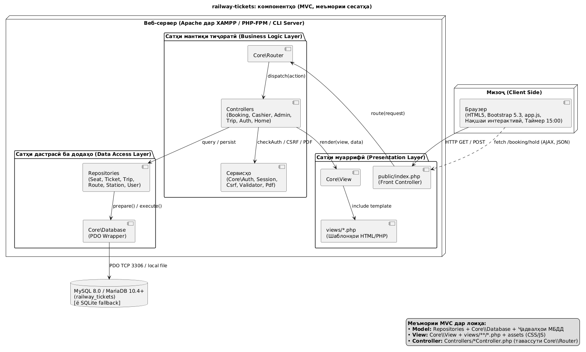
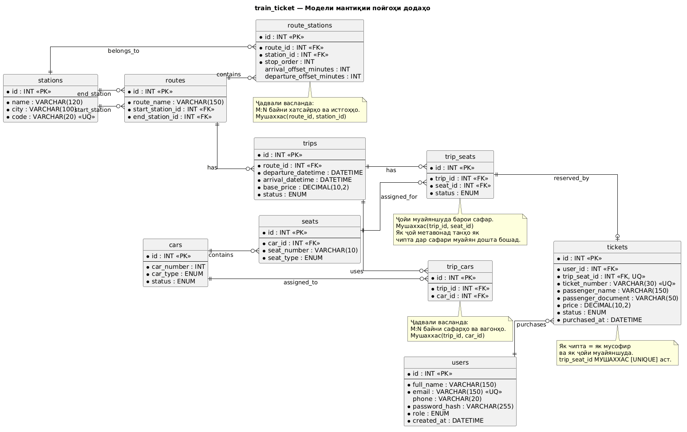
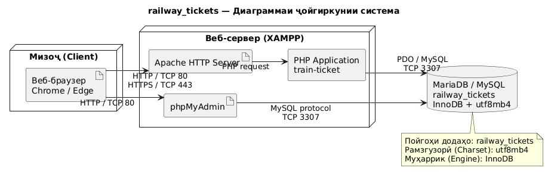

# СУПОРИШИ ТЕХНИКӢ
## барои коркарди веб-лоиҳаи фурӯши чиптаҳо барои қатораҳои байнишаҳрӣ
### «train-ticket-system»

**Сана:** 15.11.2026

**Иҷрокунанда:** <Ёрзода Мансур>

**Гурӯҳ:** <40.01.01тА>

**Фармоишгар:** Ширкати роҳи оҳан (шартан)

**Навъи ҳуҷҷат:** Супориши техникии пурра

---

# 1. Маълумоти умумӣ

## 1.1. Номи пурраи система

Веб-системаи фурӯши чиптаҳо барои қатораҳои байнишаҳрӣ бо имконияти ҷустуҷӯи сафар, интихоби вагон ва ҷой, фармоиш ва хариди чиптаи электронӣ.

## 1.2. Номи кӯтоҳи система

`train-ticket-system`

## 1.3. Асос барои коркард

Асоси коркарди система супориши таълимии фанни «Технологияҳо ва забонҳои Internet барномасозӣ» мебошад.

Лоиҳа дар доираи кори курсӣ таҳия шуда, барои автоматикунонии раванди ҷустуҷӯ ва фурӯши чиптаҳои қатораҳои байнишаҳрӣ пешбинӣ шудааст.

## 1.4. Фармоишгар ва иҷрокунанда

**Фармоишгар:** Ширкати роҳи оҳан (шартан).

**Иҷрокунанда:** Донишҷӯи курси 4-уми ихтисоси 1-400101.

## 1.5. Мӯҳлати иҷро

Мӯҳлати иҷро дар давоми семестри таълимӣ муайян карда мешавад.

## 1.6. Ҳуҷҷатҳои асосӣ

Ҳангоми коркард ҳуҷҷатҳои зерин истифода мешаванд:

- Супориши техникии лоиҳа.
- Талаботи корҳои лаборатории №1–7.
- Модели мантиқӣ ва физикии пойгоҳи додаҳо.
- Диаграммаҳои UML.
- Ҳуҷҷатҳои расмии PHP ва MySQL.

# 2. Таъинот ва мақсадҳои эҷоди система

## 2.1. Таъиноти система

Система барои автоматӣ гардонидани раванди фурӯши чиптаҳои қатораҳои байнишаҳрӣ пешбинӣ шудааст.

Система ба мусофир имконият медиҳад, ки тавассути интернет сафарро ҷустуҷӯ кунад, санаи рафтанро интихоб намояд, маълумоти қатора ва вагонро бинад, ҷойи дастрасро интихоб кунад ва чиптаи электрониро фармоиш ё харидорӣ намояд.

Маъмур тавассути панели идоракунӣ маълумоти истгоҳҳо, қатораҳо, хатсайрҳо, вагонҳо ва сафарҳоро идора мекунад.

## 2.2. Мақсади асосӣ

Мақсади асосӣ сохтани веб-системаи ягона барои осон кардани хариди онлайнии чиптаҳои қатора ва кам кардани зарурати муроҷиати мусофир ба касса мебошад.

## 2.3. Мақсадҳои мушаххас ва ченшаванда

| № | Мақсад | Нишондиҳандаи натиҷа |
|---|---|---|
| 1 | Ҷустуҷӯи сафар | Натиҷаҳо аз рӯи истгоҳ ва сана нишон дода шаванд |
| 2 | Интихоби қатора | Маълумоти қатора ва хатсайр намоиш дода шавад |
| 3 | Интихоби вагон | Вагонҳои дастраси қатора нишон дода шаванд |
| 4 | Интихоби ҷой | Ҷойҳои холӣ ва бандшуда фарқ карда шаванд |
| 5 | Хариди чипта | Чиптаи харидшуда дар пойгоҳи дода сабт шавад |
| 6 | Пешгирии фурӯши такрорӣ | Як ҷой дар як сафар ду маротиба фурӯхта нашавад |
| 7 | Идоракунии система | Маъмур маълумоти асосии системаро идора карда тавонад |

## 2.4. Натиҷаи интизоршаванда

Дар натиҷаи татбиқи система бояд веб-барномае сохта шавад, ки:

- дар браузер кор кунад;
- интерфейси забони тоҷикӣ дошта бошад;
- маълумоти сафарҳоро аз пойгоҳи дода гирад;
- интихоби вагон ва ҷойро таъмин намояд;
- маълумоти чиптаҳоро нигоҳ дорад;
- ҳуқуқҳои истифодабарандагонро мувофиқи нақшҳо маҳдуд кунад.

# 3. Тавсифи объекти автоматикунонӣ

## 3.1. Тавсифи соҳаи истифода

Объекти автоматикунонӣ раванди ҷустуҷӯ, фармоиш ва фурӯши чиптаҳои қатораҳои байнишаҳрӣ мебошад.

Дар низоми анъанавӣ мусофир барои гирифтани маълумот ва харидани чипта метавонад ба касса муроҷиат кунад. Ин раванд баъзан бо навбатпоӣ, сарфи вақт ва душвории интихоби ҷой алоқаманд аст.

Системаи пешниҳодшуда ин равандҳоро тавассути веб-барнома иҷро мекунад.

## 3.2. Иштирокчиёни система

Дар система се нақши асосӣ пешбинӣ шудааст.

| № | Нақш | Вазифа |
|---|---|---|
| 1 | Мусофир (Passenger) | Ҷустуҷӯи сафар, интихоби вагон ва ҷой, хариди чипта |
| 2 | Кассир (Cashier) | Фурӯш, ҷустуҷӯ ва баргардонидани чиптаҳо |
| 3 | Маъмур (Admin) | Идоракунии маълумот, истифодабарандагон ва ҳисобот |

## 3.3. Равандҳои асосии система

1. Бақайдгирӣ ва воридшавии истифодабаранда.
2. Ҷустуҷӯи сафар аз рӯи истгоҳи рафтан, истгоҳи расидан ва сана.
3. Намоиши рӯйхати қатораҳои дастрас.
4. Интихоби қатора ва вагон.
5. Намоиши нақшаи ҷойҳои вагон.
6. Интихоби ҷойи холӣ.
7. Фармоиш ва пардохти чипта.
8. Сабти чиптаи электронӣ.
9. Бекор кардани чипта мувофиқи қоидаҳои система.
10. Идоракунии маълумоти система аз тарафи маъмур.

## 3.4. Луғати истилоҳот

| Истилоҳ | Шарҳ |
|---|---|
| Мусофир | Шахсе, ки чиптаи қатора мехарад |
| Истгоҳ (Station) | Ҷойи рафтан ё расидани қатора |
| Хатсайр (Route) | Роҳи ҳаракати қатора байни истгоҳҳо |
| Қатора (Train) | Воситаи нақлиёти роҳи оҳан |
| Сафар (Trip) | Ҳаракати муайяни қатора бо сана ва вақти рафтан |
| Вагон (Car) | Қисми қатора, ки ҷойҳои мусофиронро дар бар мегирад |
| Ҷой (Seat) | Ҷойи муайяни мусофир дар вагон |
| Чипта (Ticket) | Ҳуҷҷати электронии тасдиқкунандаи ҳуқуқи сафар |
| Фармоиш (Booking) | Дархости мусофир барои гирифтани ҷой ё чипта |
| Пойгоҳи додаҳо | Ҷойи нигоҳдории маълумоти система |

## 3.5. Лоиҳаҳои монанд ва фарқияти система

Ҳамчун аналогҳо системаҳои Railway Tajikistan, Tutu.ru ва Trainline баррасӣ шудаанд.

| Меъёр | Railway Tajikistan | Tutu.ru | Trainline | Лоиҳаи ман |
|---|---|---|---|---|
| Ҷустуҷӯи сафар | Ҳа | Ҳа | Ҳа | Ҳа |
| Интихоби ҷой | Мувофиқи имконият | Ҳа | Ҳа | Ҳа |
| Хариди онлайн | Мувофиқи имконият | Ҳа | Ҳа | Пешбинӣ шудааст |
| Бекор кардани чипта | Мувофиқи қоидаҳо | Ҳа | Ҳа | Пешбинӣ шудааст |
| Забони тоҷикӣ | Маҳаллӣ | Маҳдуд | Маҳдуд | Ҳа |
| Идоракунии маълумот | Ҳа | Ҳа | Ҳа | Ҳа |

**Хулоса:** Лоиҳаи мазкур барои талаботи таълимӣ ва истифодаи забони тоҷикӣ мутобиқ карда шуда, интихоби вагон ва ҷойро ҳамчун вазифаи асосӣ пешбинӣ мекунад. Ҷадвал муқоисаи умумии аналогҳоро нишон медиҳад; имкониятҳои ҳар хизматрасонӣ вобаста ба хатсайр ва шартҳои он фарқ карда метавонанд.

# 4. Талабот ба система

## 4.1. Талабот ба система дар маҷмӯъ

### 4.1.1. Талабот ба сохтори система

Система бояд аз қисмҳои зерин иборат бошад:

- Интерфейси истифодабаранда (Frontend).
- Қисми серверӣ (Backend).
- Пойгоҳи додаҳо (Database).
- Қисми авторизатсия ва санҷиши ҳуқуқҳо.
- Панели идоракунии маъмур.

### 4.1.2. Талабот ба боэътимодӣ

- Маълумоти корбарон ва чиптаҳо бояд дар пойгоҳи додаҳо нигоҳ дошта шавад.
- Ҳангоми хатои амалиёт маълумоти нопурра ё нодуруст сабт нашавад.
- Барои пойгоҳи додаҳо нусхаи эҳтиётӣ мунтазам гирифта шавад.
- Ҷойи аллакай фурӯхташуда набояд дубора фурӯхта шавад.
- Амалиёти фармоиш ва харид бояд бо санҷиши дастрасии ҷой иҷро шавад.

### 4.1.3. Талабот ба амният

- Паролҳо бояд бо истифодаи алгоритми хешкунӣ нигоҳ дошта шаванд.
- Барои иҷрои амалиёт корбар бояд ворид шуда бошад.
- Ҳуқуқи ҳар корбар мувофиқи нақши ӯ муайян карда шавад.
- Дархостҳои пойгоҳи дода бояд тавассути PDO ва prepared statements иҷро шаванд.
- Маълумоти шахсии мусофир бояд аз корбарони бе иҷозат ҳифз карда шавад.
- Воридкунии маълумоти нодуруст бояд санҷида шавад.

### 4.1.4. Талабот ба суръат

- Ҷустуҷӯи сафар дар муҳити санҷишӣ бо ҳаҷми маълумоти намунавӣ бояд дар давоми на бештар аз 2 сония иҷро шавад.
- Намоиши рӯйхати сафарҳо бояд бе таъхири ғайримуқаррарӣ иҷро гардад.
- Барои тезонидани дархостҳо индексҳои зарурии пойгоҳи дода истифода шаванд.

Ин нишондиҳанда ҳадафи санҷиш мебошад ва бояд дар вақти озмоиш чен карда шавад.

### 4.1.5. Талабот ба интерфейс

- Интерфейс бояд бо забони тоҷикӣ бошад.
- Саҳифаҳо бояд содда ва фаҳмо бошанд.
- Система бояд дар компютер ва телефон дуруст намоиш дода шавад.
- Ҳолати ҷойҳо бо ранг ё аломати равшан фарқ карда шавад.

### 4.1.6. Талабот ба мутобиқат

Система бояд дар браузерҳои муосир, аз ҷумла Google Chrome ва Microsoft Edge кор кунад.

### 4.1.7. Талабот ба ҳайати истифодабарандагон

Система се гурӯҳи асосии истифодабаранда дорад:

- Мусофир.
- Кассир.
- Маъмур.

Ҳар як гурӯҳ бояд танҳо ба вазифаҳои иҷозатдодашуда дастрасӣ дошта бошад.

## 4.2. Талабот ба функсияҳо

### 4.2.1. Талаботи функсионалӣ бо MoSCoW

| Рамз | Талаботи функсионалӣ | Афзалият |
|---|---|---|
| ТФ-01 | Бақайдгирии истифодабаранда | Must |
| ТФ-02 | Воридшавӣ ва баромадан аз система | Must |
| ТФ-03 | Ҷустуҷӯи сафар аз рӯи истгоҳи рафтан, расидан ва сана | Must |
| ТФ-04 | Намоиши маълумоти қатора ва хатсайр | Must |
| ТФ-05 | Намоиши рӯйхати вагонҳои қатора | Must |
| ТФ-06 | Намоиши ҷойҳои вагон | Must |
| ТФ-07 | Интихоби ҷойи холӣ | Must |
| ТФ-08 | Санҷиши дастрасии ҷой пеш аз фармоиш | Must |
| ТФ-09 | Фармоиш ва сабти чипта | Must |
| ТФ-10 | Намоиши чиптаҳои мусофир | Must |
| ТФ-11 | Идоракунии истгоҳҳо ва хатсайрҳо | Must |
| ТФ-12 | Идоракунии қатораҳо, вагонҳо ва сафарҳо | Must |
| ТФ-13 | Бекор кардан ва баргардонидани чипта | Should |
| ТФ-14 | Сохтани ҳисобот ва содироти CSV | Could |
| ТФ-15 | Пайгирии қатора дар вақти воқеӣ | Won't |

### 4.2.2. Шарҳи MoSCoW

| Афзалият | Маъно |
|---|---|
| Must | Талаботи ҳатмӣ барои версияи аввал |
| Should | Талаботи муҳим, вале мумкин аст баъдтар иҷро шавад |
| Could | Имконияти иловагӣ |
| Won't | Дар версияи ҳозира иҷро намешавад |

### 4.2.3. User Stories

| № | User Story | Меъёри қабул |
|---|---|---|
| US-01 | Ҳамчун мусофир мехоҳам сабти ном шавам, то ба система ворид шавам | Бо маълумоти дуруст ҳисоб сохта мешавад |
| US-02 | Ҳамчун мусофир мехоҳам сафарро ҷустуҷӯ кунам, то қатораи мувофиқро ёбам | Сафарҳои мувофиқ аз рӯи истгоҳ ва сана нишон дода мешаванд |
| US-03 | Ҳамчун мусофир мехоҳам қатора ва вагонро интихоб кунам, то ҷойҳои онро бинам | Рӯйхати вагонҳо ва ҷойҳо намоиш дода мешавад |
| US-04 | Ҳамчун мусофир мехоҳам ҷойи холиро интихоб кунам, то чиптаи муайян гирам | Ҷойи бандшуда интихоб ё дубора фурӯхта намешавад |
| US-05 | Ҳамчун мусофир мехоҳам чиптаро харидорӣ кунам, то тасдиқи сафарро гирам | Чипта бо маълумоти дуруст сабт мешавад |
| US-06 | Ҳамчун маъмур мехоҳам сафарҳоро идора кунам, то маълумоти қатораҳо нав карда шавад | Маъмур метавонад маълумоти сафарро илова, тағйир ва нест кунад |

### 4.2.4. Матрисаи дастрасӣ

Дар система се нақши асосӣ истифода мешаванд: `passenger`, `cashier`, `admin`.

| Функсия | Мусофир | Кассир | Маъмур |
|---|---|---|---|
| Бақайдгирӣ | Ҳа | Не | Не |
| Воридшавӣ | Ҳа | Ҳа | Ҳа |
| Ҷустуҷӯи сафар | Ҳа | Ҳа | Ҳа |
| Дидани хатсайрҳо | Ҳа | Ҳа | Ҳа |
| Дидани қатораҳо | Ҳа | Ҳа | Ҳа |
| Интихоби вагон ва ҷой | Ҳа | Ҳа | Ҳа |
| Хариди чипта | Ҳа | Ҳа | Ҳа |
| Дидани чиптаҳои худ | Ҳа | Не | Ҳа |
| Бекор кардани чиптаи худ | Ҳа | Ҳа | Ҳа |
| Фурӯши чипта аз номи мусофир | Не | Ҳа | Ҳа |
| Идоракунии истгоҳҳо | Не | Не | Ҳа |
| Идоракунии хатсайрҳо | Не | Не | Ҳа |
| Идоракунии қатораҳо | Не | Не | Ҳа |
| Идоракунии вагонҳо | Не | Не | Ҳа |
| Идоракунии сафарҳо | Не | Не | Ҳа |
| Ҳисобот ва содироти CSV | Не | Маҳдуд | Ҳа |

**Эзоҳ:** Ҳуқуқҳои ниҳоӣ бояд бо нақшҳои воқеии ҷадвали `users` ва санҷишҳои иҷозат дар қисми серверӣ мувофиқ бошанд. Функсияҳои дар ин матритса нишон додашуда бояд дар версияи татбиқшуда санҷида шаванд.

## 4.3. Талабот ба намудҳои таъминот

### 4.3.1. Таъминоти иттилоотӣ

Барои нигоҳдорӣ ва коркарди маълумот аз пойгоҳи додаи MySQL ё MariaDB истифода мешавад.

Пойгоҳи дода аз 9 ҷадвали асосӣ иборат аст:

| № | Номи ҷадвал | Таъинот |
|---|---|---|
| 1 | users | Маълумоти истифодабарандагон ва нақшҳо |
| 2 | stations | Маълумоти истгоҳҳо |
| 3 | trains | Маълумоти қатораҳо |
| 4 | routes | Маълумоти хатсайрҳо |
| 5 | route_stations | Робитаи хатсайрҳо бо истгоҳҳо |
| 6 | trips | Маълумоти сафарҳо |
| 7 | cars | Маълумоти вагонҳо |
| 8 | seats | Маълумоти ҷойҳои вагонҳо |
| 9 | tickets | Маълумоти чиптаҳои фурӯхташуда |

Робитаҳои асосии ҷадвалҳо:

- `users` ва `tickets` — як ба бисёр (1:N).
- `routes` ва `trips` — як ба бисёр (1:N).
- `routes` ва `stations` — бисёр ба бисёр (M:N) тавассути `route_stations`.
- `trains` ва `trips` — як ба бисёр (1:N).
- `trains` ва `cars` — як ба бисёр (1:N).
- `cars` ва `seats` — як ба бисёр (1:N).
- `trips` ва `tickets` — як ба бисёр (1:N).

Барои пешгирии фурӯши такрории як ҷой дар як сафар маҳдудияти ягонагии мувофиқ дар ҷадвали `tickets` истифода мешавад.

### 4.3.2. Таъминоти барномавӣ

| Восита | Версия ё таъинот |
|---|---|
| PHP | 8.2 ё болотар |
| MySQL | 8.0 ё болотар |
| MariaDB | 10.6 ё болотар |
| HTML | Сохтори саҳифаҳо |
| CSS | Ороиши интерфейс |
| Bootstrap | 5.x |
| JavaScript | Амалҳои интерактивӣ |
| PDO | Пайвастшавӣ ба пойгоҳи дода |
| Apache | Сервери веб |
| VS Code | Муҳити таҳияи барнома |
| Git ва GitHub | Идоракунии версияҳо |

Дар қисми серверӣ PHP бе фреймворкҳои Backend истифода мешавад. Барои иҷрои дархостҳо ба пойгоҳи дода PDO истифода мегардад.

### 4.3.3. Таъминоти техникӣ

Барои таҳия ва санҷиши система таҷҳизоти зерин лозим аст:

- Компютер ё ноутбук.
- Системаи амалиётии Windows 10/11 ё Linux.
- Сервери маҳаллии XAMPP.
- Apache ва MySQL/MariaDB.
- Браузери муосир.
- Пайвасти интернет барои дастрасӣ ба GitHub.

Барои нашри система сервери веб бо PHP ва MySQL/MariaDB истифода мешавад.

### 4.3.4. Таъминоти лингвистӣ

- Забони асосии интерфейс тоҷикӣ мебошад.
- Маълумот бояд бо рамзгузории UTF-8 нигоҳ дошта шавад.
- Номҳои истгоҳҳо, мусофирон ва хатсайрҳо бо ҳуруфи кириллӣ дуруст намоиш дода шаванд.
- Номҳои техникии ҷадвалҳо ва сутунҳо бо забони англисӣ истифода мешаванд.

# 5. Моделҳои система

Дар ин бахш ҳафт диаграммаи асосии лоиҳа ҷойгир карда мешаванд. Ҳар диаграмма бояд расм ва шарҳи кӯтоҳ дошта бошад.

## 5.1. Диаграммаи вариантҳои истифода (Use Case Diagram)



**Шарҳ:** Диаграммаи Use Case робитаи се нақши асосӣ — мусофир, кассир ва маъмурро бо вазифаҳои система нишон медиҳад. Мусофир сафарро ҷустуҷӯ ва чиптаро харидорӣ мекунад. Кассир амалиёти фурӯш ва баргардониданро иҷро мекунад. Маъмур маълумоти асосии системаро идора менамояд.

## 5.2. Диаграммаи фаъолият (Activity Diagram)



**Шарҳ:** Диаграммаи Activity пайдарпайии амалҳои мусофирро нишон медиҳад: воридшавӣ ба система, ҷустуҷӯи сафар, интихоби қатора, интихоби вагон, интихоби ҷой, санҷиши дастрасӣ, харид ва гирифтани чипта.

## 5.3. Диаграммаи пайдарпайӣ (Sequence Diagram)



**Шарҳ:** Диаграммаи Sequence мубодилаи паёмҳоро байни мусофир, интерфейси веб, контроллер, қабати коркарди маълумот ва пойгоҳи дода нишон медиҳад. Он тартиби иҷрои амали интихоби ҷой ва сабти чиптаро шарҳ медиҳад.

## 5.4. Диаграммаи синфҳо (Class Diagram)



**Шарҳ:** Диаграммаи Class сохтори синфҳои асосии система, атрибутҳо ва алоқаи байни онҳоро нишон медиҳад. Синфҳои User, Station, Train, Route, Trip, Car, Seat ва Ticket объектҳои асосии лоиҳаро ифода мекунанд.

## 5.5. Диаграммаи компонентҳо (Component Diagram)



**Шарҳ:** Диаграммаи Component сохтори меъмории системаро нишон медиҳад. Система аз се қабати асосӣ иборат аст: интерфейси истифодабаранда, қисми серверӣ ва пойгоҳи додаҳо. Контроллерҳо, хизматрасониҳо ва репозиторийҳо вазифаҳои муайян доранд.

## 5.6. Диаграммаи модели мантиқии пойгоҳи додаҳо (ER Diagram)



**Шарҳ:** Диаграммаи ER ҷадвалҳои пойгоҳи дода ва робитаи байни онҳоро нишон медиҳад. Дар он 9 ҷадвали асосии система, калидҳои аввалия ва хориҷӣ ва муносибатҳои 1:N ва M:N инъикос шудаанд.

## 5.7. Диаграммаи ҷойгиркунӣ (Deployment Diagram)



**Шарҳ:** Диаграммаи Deployment ҷойгиршавии қисмҳои техникии системаро нишон медиҳад. Истифодабаранда тавассути браузер ба сервери Apache муроҷиат мекунад. PHP дархостҳоро коркард карда, тавассути PDO бо MySQL/MariaDB пайваст мешавад.

# 6. Таркиб ва мундариҷаи корҳо

Таҳияи система дар шаш марҳилаи асосӣ иҷро карда мешавад.

| № | Марҳила | Корҳои иҷрошаванда | Натиҷаи марҳила | Мӯҳлат |
|---|---|---|---|---|
| 1 | Лоиҳакашӣ | Таҳлили соҳа, таҳияи СТ, диаграммаҳо ва пойгоҳи дода | Ҳуҷҷатҳои лоиҳа ва schema.sql | 16.11.2026 |
| 2 | Дизайн | Тарҳрезии интерфейс ва саҳифаҳои система | Макет ва прототип | 17.11.2026 |
| 3 | Frontend | HTML, CSS, Bootstrap ва JavaScript | Саҳифаҳои веб | 18–19.11.2026 |
| 4 | Backend | PHP, PDO, MySQL, авторизатсия ва коркарди фармоиш | MVP-и коркунанда | 20–21.11.2026 |
| 5 | Санҷиш | Санҷиши функсияҳо, SQL ва амнияти система | Натиҷаи санҷишҳо | 22.11.2026 |
| 6 | Нашр | Омодасозӣ ва ҷойгиркунии система дар сервер | Версияи нашршуда | 23.11.2026 |

**Эзоҳ:** Санаҳо нақшаи пешниҳодӣ мебошанд. Онҳоро бо санаҳои воқеии нақшаи дарсии гурӯҳ мутобиқ кардан лозим аст.

# 7. Тартиби назорат ва қабул

## 7.1. Тартиби санҷиши система

Санҷиши система бо истифода аз маълумоти намунавӣ ва ҳисобҳои санҷишии мусофир, кассир ва маъмур гузаронида мешавад.

| № | Амали санҷиш | Натиҷаи интизоршаванда |
|---|---|---|
| 1 | Бақайдгирии мусофир | Ҳисоби нав сохта мешавад |
| 2 | Воридшавӣ ба система | Истифодабаранда ба система ворид мешавад |
| 3 | Ҷустуҷӯи сафар | Сафарҳои мувофиқ нишон дода мешаванд |
| 4 | Интихоби қатора | Маълумоти қатора нишон дода мешавад |
| 5 | Интихоби вагон | Вагонҳои қатора намоиш дода мешаванд |
| 6 | Интихоби ҷой | Ҷойҳои дастрас нишон дода мешаванд |
| 7 | Интихоби ҷойи бандшуда | Система интихобро рад мекунад |
| 8 | Хариди чипта | Чипта дар пойгоҳи дода сабт мешавад |
| 9 | Дидани чипта | Маълумоти чиптаи мусофир нишон дода мешавад |
| 10 | Санҷиши ҳуқуқи мусофир | Мусофир ба панели маъмур дастрасӣ надорад |
| 11 | Идоракунии маълумот | Маъмур метавонад маълумотро идора кунад |
| 12 | Иҷрои JOIN | Маълумот аз ҷадвалҳои алоқаманд дуруст гирифта мешавад |

## 7.2. Санҷиши пойгоҳи додаҳо

Барои санҷиши пойгоҳи дода се файли SQL истифода мешавад:

- `schema.sql` — сохтани пойгоҳи дода ва ҷадвалҳо.
- `seed.sql` — ворид кардани маълумоти намунавӣ.
- `queries.sql` — иҷрои дархостҳои санҷишӣ.

Санҷишҳо дар phpMyAdmin ё MySQL иҷро карда мешаванд.

Дархости намунавии JOIN:

```sql
SELECT
    tk.ticket_number,
    tk.passenger_name,
    tr.train_number,
    r.name AS route_name,
    tp.departure_time,
    tk.price,
    tk.status
FROM tickets tk
JOIN trips tp ON tp.id = tk.trip_id
JOIN trains tr ON tr.id = tp.train_id
JOIN routes r ON r.id = tp.route_id
ORDER BY tp.departure_time;
```

Ин дархост маълумотро аз ҷадвалҳои `tickets`, `trips`, `trains` ва `routes` гирифта, дар як натиҷа нишон медиҳад.

## 7.3. Меъёрҳои қабул

Система қабулшуда ҳисобида мешавад, агар:

1. Ҳамаи талаботи функсионалии гурӯҳи Must иҷро шуда бошанд.
2. Бақайдгирӣ ва воридшавӣ дуруст кор кунанд.
3. Ҷустуҷӯи сафар аз рӯи истгоҳ ва сана натиҷаи дуруст диҳад.
4. Интихоби вагон ва ҷой дуруст иҷро шавад.
5. Як ҷой дар як сафар такроран фурӯхта нашавад.
6. Маълумоти чипта дуруст сабт ва намоиш дода шавад.
7. Ҳуқуқҳои мусофир, кассир ва маъмур риоя шаванд.
8. Дар санҷишҳои асосӣ хатогиҳои критикӣ мавҷуд набошанд.
9. Дархостҳои SQL натиҷаҳои интизоршавандаро баргардонанд.

**Меъёри умумӣ:** Система вақте қабулшуда ҳисобида мешавад, ки 100% талаботи Must иҷро шуда, ҳамаи санҷишҳои асосӣ бомуваффақият гузаранд ва хатогиҳои критикӣ боқӣ намонанд.

# 8. Талабот ба ҳуҷҷатгузорӣ

Ҳуҷҷатҳои лоиҳа бояд барои насб, истифода, санҷиш ва нигоҳдории система кофӣ бошанд.

| № | Номи ҳуҷҷат | Таъинот |
|---|---|---|
| 1 | README.md | Маълумоти умумӣ ва тарзи оғоз кардани лоиҳа |
| 2 | 01-domain-analysis.md | Таҳлили соҳаи истифода |
| 3 | 02-comparison-matrix.md | Матритсаи муқоисавии аналогҳо |
| 4 | 03-short-spec.md | Супориши техникии кӯтоҳ |
| 5 | 04-behavior/ | Диаграммаҳои рафторӣ |
| 6 | 05-structure/ | Диаграммаҳои сохторӣ |
| 7 | 06-er-diagram.png | Модели ER |
| 8 | 07-deployment.puml | Манбаи диаграммаи Deployment |
| 9 | 07-deployment.png | Расми диаграммаи Deployment |
| 10 | 08-technical-specification.md | Супориши техникии пурра |
| 11 | database/schema.sql | Сохтани пойгоҳи дода |
| 12 | database/seed.sql | Маълумоти намунавӣ |
| 13 | database/queries.sql | Дархостҳои SQL |
| 14 | 07-screens/ | Скриншотҳои санҷиш ва натиҷаҳо |

## 8.1. Талабот ба тарзи нигоҳдории ҳуҷҷатҳо

- Ҳуҷҷатҳои матнӣ дар формати Markdown нигоҳ дошта шаванд.
- Диаграммаҳо дар формати PNG ҷойгир карда шаванд.
- Файлҳои SQL дар папкаи `database` нигоҳ дошта шаванд.
- Ҳамаи файлҳо дар GitHub ҷойгир карда шаванд.
- Роҳҳои расмҳо нисбӣ бошанд, на роҳҳои мутлақи компютер.
- Номҳои файлҳо дар матн ва дар репозиторий якхела бошанд.

# 9. Манбаъҳои коркард

Ҳангоми таҳияи система аз манбаъҳои зерин истифода мешавад:

1. ГОСТ 34.602 — талабот ба таркиби супориши техникии системаҳои автоматикунонидашуда.
2. Маводи лексияҳои фанни «Технологияҳо ва забонҳои Internet барномасозӣ».
3. Ҳуҷҷатҳои расмии PHP — https://www.php.net/docs.php
4. Ҳуҷҷатҳои расмии MySQL — https://dev.mysql.com/doc/
5. Ҳуҷҷатҳои расмии MariaDB — https://mariadb.com/kb/en/documentation/
6. Ҳуҷҷатҳои расмии Bootstrap — https://getbootstrap.com/docs/
7. PlantUML — https://plantuml.com/
8. GitHub Docs — https://docs.github.com/
9. Railway Tajikistan — https://railway.tj/
10. Tutu.ru — https://www.tutu.ru/
11. Trainline — https://www.thetrainline.com/

---

# ХУЛОСА

Дар натиҷаи иҷрои супориши техникӣ талабот, мақсадҳо, нақшҳо, вазифаҳо, моделҳои рафторӣ ва сохтории веб-системаи фурӯши чиптаҳои қатораҳои байнишаҳрӣ муайян карда шуданд.

Система барои осон кардани ҷустуҷӯ ва хариди чиптаҳо, интихоби вагон ва ҷой, нигоҳдории маълумоти мусофирон ва идоракунии сафарҳо пешбинӣ шудааст.

Моделҳои UML, модели ER ва диаграммаи Deployment сохтор ва фаъолияти системаро нишон медиҳанд. Пойгоҳи дода аз 9 ҷадвали асосӣ иборат буда, робитаҳои байни онҳо тавассути калидҳои аввалия ва хориҷӣ ташкил карда мешаванд.

Супориши техникӣ ҳамчун ҳуҷҷати асосӣ барои таҳия, санҷиш ва қабули веб-система истифода мешавад.