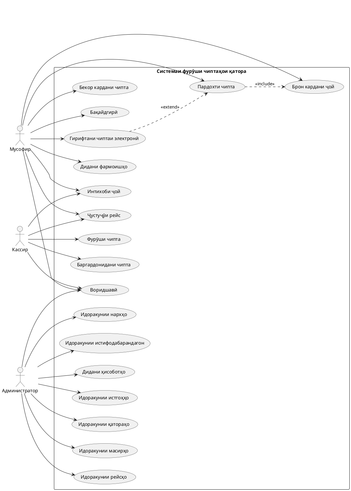
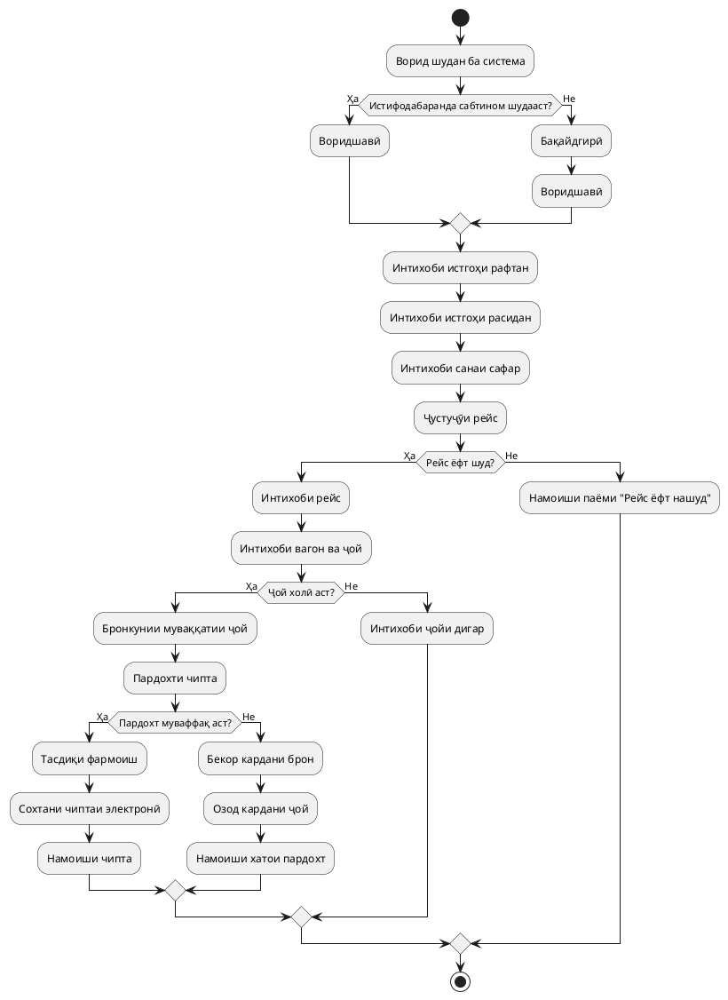
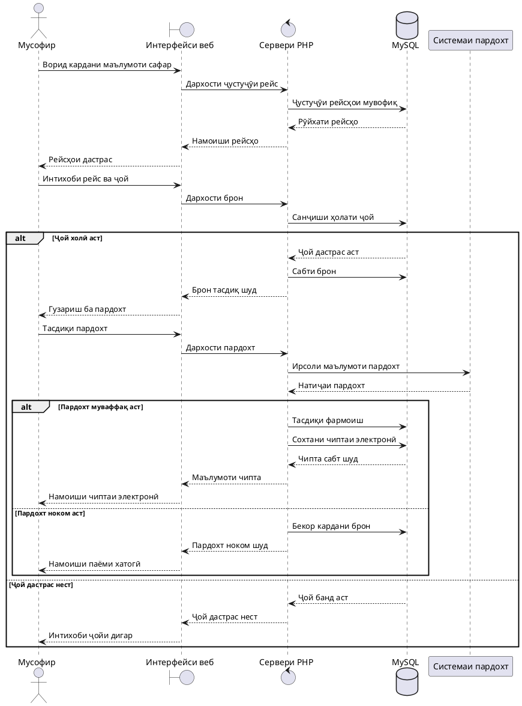
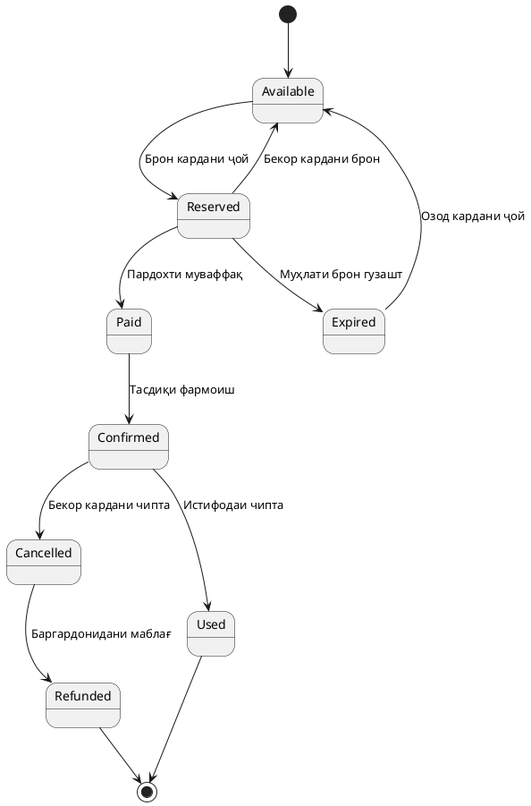

# ЛАБОРАТОРИЯИ № 1

# Мавзӯъ: Коркарди веб-лоиҳаи «Фурӯши чиптаҳои қатораҳои байнишаҳрӣ»

## МУНДАРИҶА

1. Таҳлили соҳаи предметӣ
2. Матритсаи муқоисавии лоиҳаҳои монанд
3. Супориши техникии кӯтоҳ
4. Модели рафтори лоиҳа (UML)
5. Хулоса
6. Манбаъҳои истифодашуда

---

# 1. ТАҲЛИЛИ СОҲАИ ПРЕДМЕТӢ

## 1.1. Тавсифи соҳа

Соҳаи предметии лоиҳаи мазкур ба ташкили хизматрасонии мусофиркашонӣ тавассути қатораҳои байнишаҳрӣ ва фурӯши чиптаҳои роҳи оҳан вобаста мебошад.

Дар айни замон фурӯши чиптаҳо тавассути кассаҳои роҳи оҳан ва системаҳои электронии фармоиш анҷом дода мешавад. Ҳангоми харид аз касса мусофир ба корманди фурӯш муроҷиат намуда, самти сафар, сана ва намуди ҷойро муайян мекунад. Дар системаҳои электронӣ бошад, мусофир метавонад тавассути интернет маълумоти заруриро ҷустуҷӯ намуда, чиптаро фармоиш диҳад.

Бо вуҷуди рушди технологияҳои иттилоотӣ, дар раванди фурӯши чиптаҳо баъзе мушкилот ба назар мерасанд. Аз ҷумла, дар кассаҳо навбатҳои зиёд пайдо мешаванд, санҷидани ҷойҳои холӣ вақти иловагӣ талаб мекунад ва маълумоти ҷадвали ҳаракат на ҳамеша сари вақт нав карда мешавад. Ҳамчунин, ҳангоми ҳамзамон фурӯхтани чиптаҳо аз якчанд нуқта эҳтимоли иштибоҳ ва фурӯши такрории як ҷой вуҷуд дорад.

Бо мақсади ҳалли ин мушкилот таҳияи веб-системаи ягонаи фурӯши чиптаҳои қатораҳои байнишаҳрӣ пешниҳод карда мешавад. Система бояд имконияти ҷустуҷӯи рейсҳо, интихоби ҷой, бронкунӣ, пардохт, гирифтани чиптаи электронӣ ва идоракунии маълумоти қатораҳоро фароҳам оварад.

## 1.2. Иштирокчиёни система (нақшҳо)

Дар системаи мазкур се иштирокчии асосӣ муайян карда мешаванд.

| Нақш | Вазифа | Амалҳои асосӣ |
|---|---|---|
| Мусофир (Passenger) | Истифодабаранда ва харидори чипта | Бақайдгирӣ, воридшавӣ, ҷустуҷӯи рейс, интихоби ҷой, бронкунӣ, пардохт ва бекоркунӣ |
| Кассир (Cashier) | Корманди фурӯши чипта дар касса | Ҷустуҷӯи рейс, санҷиши ҷойҳои холӣ, фурӯши чипта ва баргардонидани чипта |
| Администратор (Administrator) | Идоракунанда ва назораткунандаи система | Идоракунии истгоҳҳо, қатораҳо, вагонҳо, рейсҳо, нархҳо ва ҳисоботҳо |

### Шарҳи нақшҳо

- **Мусофир:** метавонад тавассути сомона рейси мувофиқро ҷустуҷӯ намуда, чипта харад.
- **Кассир:** ба мусофироне, ки шахсан ба касса муроҷиат мекунанд, хизмат мерасонад.
- **Администратор:** фаъолияти умумии системаро назорат намуда, маълумоти асосии онро идора мекунад.

## 1.3. Мафҳумҳои асосӣ (луғат)

| Мафҳум | Маъно |
|---|---|
| Истгоҳ (Station) | Ҷойи муайяншуда барои таваққуф ва ҳаракати қатораҳо |
| Қатора (Train) | Воҳиди нақлиётии роҳи оҳан, ки дорои рақам ва вагонҳо мебошад |
| Масир (Route) | Самти ҳаракати қатора аз истгоҳи оғоз то истгоҳи анҷом |
| Рейс (Trip) | Ҳаракати қатораи мушаххас аз рӯйи масир дар сана ва вақти муайян |
| Вагон (Carriage) | Қисми таркиби қатора барои ҷойгир кардани мусофирон |
| Ҷой (Seat) | Ҷойи рақамдор барои нишастани мусофир дар вагон |
| Брон (Reservation) | Муҳлати муваққатии нигоҳ доштани ҷой то анҷоми пардохт |
| Чипта (Ticket) | Ҳуҷҷати электронӣ ё коғазӣ, ки ҳуқуқи мусофирро барои сафар тасдиқ мекунад |
| Фармоиш (Order) | Сабти дархости мусофир барои харидории чипта |
| Пардохт (Payment) | Амалиёти пардохти маблағи чипта |
| Баргардонидан (Refund) | Амалиёти баргардонидани маблағ тибқи қоидаҳои муқарраршуда |
| Ҷадвали ҳаракат (Schedule) | Маълумот дар бораи вақт ва самти ҳаракати қатораҳо |
| Чиптаи электронӣ (E-ticket) | Чиптаи рақамӣ, ки баъди тасдиқи фармоиш ба вуҷуд меояд |

## 1.4. Равандҳои асосии система

### 1. Ҷустуҷӯи рейс

Мусофир маълумоти зеринро интихоб мекунад:

- Истгоҳи рафтан.
- Истгоҳи расидан.
- Санаи сафар.
- Шумораи мусофирон.

Система мувофиқи маълумоти воридшуда рейсҳои мувофиқро ҷустуҷӯ карда, натиҷаҳоро нишон медиҳад.

### 2. Бронкунӣ ва пардохти чипта

Мусофир рейси мувофиқро интихоб намуда, вагон ва ҷойи холиро муайян мекунад. Баъд аз интихоби ҷой система онро барои муҳлати муайян муваққатан нигоҳ медорад. Пас аз анҷоми пардохт фармоиш тасдиқ гардида, чиптаи электронӣ сохта мешавад.

### 3. Бекор кардан ва баргардонидани чипта

Мусофир метавонад дар доираи қоидаҳои муқарраршуда чиптаи худро бекор кунад. Система ҳолати чиптаро тағйир дода, дар сурати иҷозат будани баргардонидани маблағ амалиёти мувофиқро сабт мекунад.

### 4. Идоракунии ҷадвали рейсҳо

Администратор маълумоти қатораҳо, истгоҳҳо, масирҳо, вагонҳо, ҷойҳо, вақтҳои ҳаракат ва нархҳоро идора мекунад.

### 5. Фурӯши чипта тавассути кассир

Кассир маълумоти мусофир ва самти сафарро ворид намуда, ҷойҳои дастрасро месанҷад. Баъд аз интихоби ҷой ва анҷоми пардохт чипта ба мусофир дода мешавад.

## 1.5. Мушкилоти мавҷуда ва роҳҳои ҳалли онҳо

| № | Мушкилоти мавҷуда | Роҳи ҳалли пешниҳодшуда |
|---|---|---|
| 1 | Навбатҳои зиёд дар кассаҳо | Ташкили фурӯши чиптаҳои онлайнӣ |
| 2 | Душвории ҷустуҷӯи рейсҳо | Ҷустуҷӯи автоматӣ аз рӯйи истгоҳ ва сана |
| 3 | Набудани маълумоти дақиқ дар бораи ҷойҳои холӣ | Намоиши ҳолати ҷойҳо |
| 4 | Эҳтимоли фурӯши такрории як ҷой | Назорати ягонаи ҳолати ҷой дар пойгоҳи додаҳо |
| 5 | Нав нашудани ҷадвали ҳаракат | Имконияти навсозии ҷадвал аз тарафи администратор |
| 6 | Душвории нигоҳдории маълумоти чиптаҳо | Истифодаи пойгоҳи додаҳои MySQL |
| 7 | Вақти зиёд барои хариди чипта | Автоматӣ намудани раванди фармоиш |
| 8 | Душвории ёфтани маълумоти фармоиши пешина | Таърихи фармоишҳо дар ҳисоби шахсӣ |
| 9 | Мушкилоти бекор кардани чипта | Ташкили механизми бекоркунӣ |
| 10 | Набудани назорати умумии фурӯш | Ташкили панели маъмурӣ ва ҳисоботҳо |

## 1.6. Мақсад ва вазифаҳои таҳияи система

### Мақсади асосӣ

Таҳияи веб-системаи муосир барои автоматӣ намудани раванди ҷустуҷӯ, бронкунӣ ва фурӯши чиптаҳои қатораҳои байнишаҳрӣ.

### Вазифаҳои асосӣ

1. Сохтани интерфейси қулай барои мусофирон.
2. Ташкили бақайдгирӣ ва воридшавии истифодабарандагон.
3. Сохтани системаи ҷустуҷӯи рейсҳо.
4. Намоиши ҷадвали ҳаракати қатораҳо.
5. Ташкили интихоби вагон ва ҷой.
6. Сохтани механизми бронкунии муваққатӣ.
7. Ташкили раванди пардохти чипта.
8. Сохтани чиптаи электронӣ.
9. Ташкили бекоркунӣ ва баргардонидани чипта.
10. Сохтани панели идоракунии администратор.
11. Нигоҳдории маълумот дар пойгоҳи додаҳои MySQL.

## 1.7. Саволҳои назоратӣ ва ҷавобҳо

**1. Соҳаи предметӣ чист?**

Соҳаи предметӣ соҳаи муайяни фаъолияти инсон мебошад, ки дар доираи он система барои ҳалли масъалаҳо таҳия карда мешавад. Дар лоиҳаи мазкур соҳаи предметӣ фурӯши чиптаҳои қатораҳои байнишаҳрӣ мебошад.

**2. Иштирокчиёни асосии система кадомҳоянд?**

Иштирокчиёни асосӣ мусофир, кассир ва администратор мебошанд.

**3. Масир ва рейс аз ҳам чӣ фарқ доранд?**

Масир самти ҳаракати қатораро муайян мекунад. Рейс бошад, ҳаракати қатораи мушаххас аз рӯйи ҳамон масир дар сана ва вақти муайян мебошад.

**4. Бронкунӣ чист?**

Бронкунӣ муваққатан нигоҳ доштани ҷой барои мусофир то анҷоми пардохт мебошад.

**5. Чиптаи электронӣ чист?**

Чиптаи электронӣ ҳуҷҷати рақамиест, ки маълумоти мусофир, масир, сана, вақти сафар ва ҷойи нишастро дар бар гирифта, ҳуқуқи сафарро тасдиқ мекунад.

**6. Барои чӣ пойгоҳи додаҳо зарур аст?**

Пойгоҳи додаҳо барои нигоҳдорӣ, ҷустуҷӯ, тағйир ва идоракунии маълумоти истифодабарандагон, қатораҳо, рейсҳо, ҷойҳо, фармоишҳо ва пардохтҳо зарур мебошад.

**7. Чаро пешгирии фурӯши такрории як ҷой муҳим аст?**

Зеро як ҷой набояд ҳамзамон ба ду мусофир фурӯхта шавад. Барои ин система бояд ҳангоми брон ва пардохт ҳолати ҷойро санҷида, тағйиротро дар пойгоҳи додаҳо бехатар сабт намояд.

**8. Вазифаи администратор аз чӣ иборат аст?**

Администратор қатораҳо, истгоҳҳо, масирҳо, ҷадвали ҳаракат, нархҳо ва фармоишҳоро идора намуда, фаъолияти системаро назорат мекунад.

---

# 2. МАТРИСАИ МУҚОИСАВИИ ЛОИҲАҲОИ МОНАНД

## 2.1. Мақсади таҳлили лоиҳаҳои монанд

Пеш аз таҳияи веб-лоиҳаи нав омӯзиши системаҳои мавҷудаи фурӯши чиптаҳои қатора зарур мебошад. Ин таҳлил имкон медиҳад, ки имкониятҳо, афзалиятҳо ва камбудиҳои системаҳои мавҷуда муайян карда шаванд.

Барои муқоиса се системаи воқеӣ интихоб карда мешаванд:

1. Railway Tajikistan.
2. Tutu.ru.
3. Trainline.

## 2.2. Railway Tajikistan

**Номи система:** Railway Tajikistan.

**Сомонаи расмӣ:** https://www.railway.tj/

**Соҳаи фаъолият:** Фурӯши чиптаҳои роҳи оҳан дар Тоҷикистон.

Роҳи оҳани Тоҷикистон хизматрасонии электронии хариди чиптаро пешниҳод мекунад. Истифодабаранда метавонад тавассути сомона маълумоти зарурии сафарро ҷустуҷӯ намуда, чипта фармоиш ва пардохт кунад.

### Имкониятҳои асосӣ

- Ҷустуҷӯи чиптаҳо.
- Интихоби самти сафар.
- Ворид намудани маълумоти мусофир.
- Пардохти электронӣ.
- Гирифтани тасдиқи чиптаи электронӣ.
- Баргардонидани чипта тибқи қоидаҳо.

### Афзалиятҳо

- Барои бозори Тоҷикистон пешбинӣ шудааст.
- Хизматрасонии электронии чиптаҳоро пешниҳод мекунад.
- Қоидаҳои харид ва баргардонидани чипта муайян шудаанд.

### Маҳдудиятҳо

- Баъзе амалиётҳои баргардонидани маблағ метавонанд ба муроҷиат ба касса вобаста бошанд.
- Имкониятҳои система аз хизматрасонии дастрас вобастаанд.
- Барои лоиҳаи таълимии мо идоракунии мустақили қатораҳо, вагонҳо ва ҳисоботҳоро бояд алоҳида таҳия кунем.

## 2.3. Tutu.ru

**Номи система:** Tutu.ru.

**Сомонаи расмӣ:** https://www.tutu.ru/

**Соҳаи фаъолият:** Ҷустуҷӯ ва фурӯши чиптаҳои нақлиётӣ.

Tutu.ru системаи фармоиши чиптаҳо мебошад, ки ба истифодабарандагон имконияти ҷустуҷӯи қатораҳо, муқоисаи нархҳо ва интихоби ҷойҳои мувофиқро фароҳам меорад.

### Имкониятҳои асосӣ

- Ҷустуҷӯи қатора аз рӯйи истгоҳ ва сана.
- Намоиши вақти рафтан ва расидан.
- Намоиши давомнокии сафар.
- Интихоби навъи вагон.
- Интихоби ҷойи холӣ.
- Ворид намудани маълумоти мусофир.
- Пардохти электронӣ.
- Гирифтани чиптаи электронӣ.
- Бекоркунӣ ва баргардонидани чипта тибқи қоидаҳо.

### Афзалиятҳо

- Интерфейси қулай ва фаҳмо.
- Имконияти муқоисаи қатораҳо.
- Намоиши ҷойҳои дастрас ва нархи онҳо.
- Тартиби муайяни бронкунӣ ва пардохт.

### Маҳдудиятҳо

- Баъзе хизматрасониҳо танҳо барои самтҳои муайян дастрасанд.
- Қоидаҳои баргардонидани чипта аз шартҳои интиқолдиҳанда вобаста мебошанд.
- Барои идоракунии мустақили инфрасохтори роҳи оҳан пешбинӣ нашудааст.

## 2.4. Trainline

**Номи система:** Trainline.

**Сомонаи расмӣ:** https://www.thetrainline.com/

**Соҳаи фаъолият:** Ҷустуҷӯ ва хариди чиптаҳои қатора ва автобус.

Trainline платформаи электронии сафар мебошад, ки ба истифодабарандагон имконияти ҷустуҷӯ ва муқоисаи вариантҳои гуногуни сафарро медиҳад.

### Имкониятҳои асосӣ

- Ҷустуҷӯи хатсайрҳои қатора.
- Намоиши ҷадвали ҳаракат.
- Муқоисаи нархи чиптаҳо.
- Интихоби вақти мувофиқи сафар.
- Хариди чиптаи электронӣ.
- Нигоҳдории чиптаҳо дар барномаи мобилӣ.
- Истифодаи чиптаҳои рақамӣ тавассути телефон.

### Афзалиятҳо

- Интерфейси муосир.
- Имконияти муқоисаи вариантҳои сафар.
- Дастгирии чиптаҳои рақамӣ.
- Нигоҳдории чиптаҳо дар ҳисоби истифодабаранда.

### Маҳдудиятҳо

- Хизматрасонӣ ва имкониятҳо аз кишвар ва интиқолдиҳанда вобастаанд.
- Барои хатсайрҳои Тоҷикистон ҳамчун системаи мустақили маҳаллӣ пешбинӣ нашудааст.
- Имкониятҳои интихоби ҷой аз хизматрасонии ширкати роҳи оҳан вобаста мебошанд.

## 2.5. Матритсаи муқоисавӣ

| № | Меъёрҳои муқоиса | Railway Tajikistan | Tutu.ru | Trainline |
|---|---|---|---|---|
| 1 | Ҷустуҷӯи қатораҳо | ✓ | ✓ | ✓ |
| 2 | Интихоби санаи сафар | ✓ | ✓ | ✓ |
| 3 | Намоиши ҷадвали ҳаракат | ✓ | ✓ | ✓ |
| 4 | Намоиши нархи чипта | ✓ | ✓ | ✓ |
| 5 | Интихоби ҷой | ✓ | ✓ | Вобаста ба рейс |
| 6 | Бронкунии чипта | ✓ | ✓ | ✓ |
| 7 | Пардохти электронӣ | ✓ | ✓ | ✓ |
| 8 | Чиптаи электронӣ | ✓ | ✓ | ✓ |
| 9 | Баргардонидани чипта | ✓ | ✓ | ✓ |
| 10 | Истифодаи мобилӣ | ✓ | ✓ | ✓ |
| 11 | Муқоисаи вариантҳои сафар | Маҳдуд | ✓ | ✓ |
| 12 | Мутобиқшавӣ ба бозори Тоҷикистон | ✓ | Маҳдуд | Маҳдуд |

**Эзоҳ:** Аломати ✓ маънои дастгирии имкониятро дорад. Имкониятҳои воқеии ҳар як система метавонанд вобаста ба рейс, интиқолдиҳанда ва қоидаҳои хизматрасонӣ фарқ кунанд.

## 2.6. Ҷадвали афзалиятҳо ва маҳдудиятҳо

| Лоиҳа | Афзалиятҳо | Маҳдудиятҳо |
|---|---|---|
| Railway Tajikistan | Мутобиқ ба бозори маҳаллӣ, хариди электронӣ | Баъзе амалиётҳо бо касса вобастаанд |
| Tutu.ru | Ҷустуҷӯи қулай, интихоби ҷой, муқоисаи нарх | Маҳдудияти хизматрасонӣ аз интиқолдиҳанда вобаста аст |
| Trainline | Интерфейси муосир, муқоисаи сафарҳо, чиптаи рақамӣ | Барои бозори маҳаллии Тоҷикистон мутобиқ нест |

## 2.7. Хулосаи матритсаи муқоисавӣ

Дар натиҷаи таҳлил муайян гардид, ки ҳар се система барои осон намудани раванди ҷустуҷӯ ва хариди чиптаҳои қатора имкониятҳои муфид доранд.

Аз Railway Tajikistan тарзи мутобиқсозии система ба шароити нақлиёти Тоҷикистонро истифода бурдан мумкин аст. Аз Tutu.ru тарзи ҷустуҷӯи рейсҳо, интихоби вагон ва ҷойро омӯхтан мумкин аст. Аз Trainline бошад, тарҳи муосири интерфейс ва тарзи нигоҳдории чиптаҳои электронӣ намуна шуда метавонанд.

Навоварии лоиҳаи пешниҳодшаванда сохтани веб-системаи ягонаи таълимӣ бо забони тоҷикӣ мебошад, ки дар он мусофир, кассир ва администратор мувофиқи ҳуқуқҳои худ амал карда метавонанд.

---

# 3. СУПОРИШИ ТЕХНИКИИ КӮТОҲ

## 3.1. Номи лоиҳа

«Фурӯши чиптаҳо барои қатораҳои байнишаҳрӣ».

Номи англисӣ: `Intercity Train Ticket Booking System`.

## 3.2. Асос барои таҳияи лоиҳа

Асоси таҳияи лоиҳа зарурати автоматӣ намудани раванди ҷустуҷӯ, бронкунӣ ва фурӯши чиптаҳои қатораҳои байнишаҳрӣ мебошад.

Дар системаҳои анъанавӣ мусофирон барои гирифтани маълумот ва харидани чипта ба кассаҳо муроҷиат мекунанд. Ин раванд метавонад боиси сарфи зиёди вақт, навбат ва мушкилоти дастрасӣ ба маълумот гардад.

Аз ин рӯ, таҳияи веб-системаи ягона барои осон намудани хизматрасонӣ ва беҳтар намудани идоракунии раванди фурӯши чиптаҳо зарур мебошад.

## 3.3. Мақсади таҳияи лоиҳа

Мақсади асосии лоиҳа сохтани веб-системаи автоматиконидашуда мебошад, ки ба мусофирон имконияти ҷустуҷӯ, интихоби рейс, бронкунӣ ва хариди чиптаҳои қатораҳои байнишаҳриро тавассути интернет фароҳам меорад.

Ҳамзамон система бояд барои кассир ва администратор воситаҳои идоракунии маълумот ва назорати амалиётҳоро таъмин намояд.

## 3.4. Вазифаҳои асосии система

1. Таҳияи интерфейси истифодабаранда.
2. Сохтани шакли бақайдгирӣ ва воридшавӣ.
3. Идоракунии маълумоти истифодабарандагон.
4. Сохтани ҷустуҷӯи қатораҳо аз рӯйи истгоҳ ва сана.
5. Намоиши рӯйхати рейсҳои дастрас.
6. Намоиши вақти рафтан ва расидан.
7. Намоиши нархи чиптаҳо.
8. Интихоби навъи вагон ва ҷойи нишаст.
9. Бронкунии муваққатии ҷой.
10. Ташкили раванди пардохт.
11. Сохтани чиптаи электронӣ.
12. Намоиши таърихи фармоишҳо.
13. Ташкили бекоркунӣ ва баргардонидани чипта.
14. Сохтани панели идоракунии администратор.
15. Ташкили ҳисобот оид ба фурӯш ва фармоишҳо.

## 3.5. Истифодабарандагони система

| Истифодабаранда | Ҳуқуқ ва имкониятҳо |
|---|---|
| Мусофир | Бақайдгирӣ, воридшавӣ, ҷустуҷӯи рейс, интихоби ҷой, фармоиш, пардохт ва дидани чиптаҳо |
| Кассир | Ҷустуҷӯи рейс, фурӯши чипта, санҷиши ҷойҳои холӣ ва баргардонидани чипта |
| Администратор | Идоракунии истифодабарандагон, истгоҳҳо, қатораҳо, вагонҳо, рейсҳо, нархҳо ва ҳисоботҳо |

## 3.6. Талаботи функсионалӣ

Талаботи функсионалӣ амалҳоеро муайян мекунанд, ки система бояд иҷро намояд.

| Рамз | Талабот | Тавсиф |
|---|---|---|
| FR-01 | Бақайдгирӣ | Система бояд имконияти сохтани ҳисоби навро диҳад |
| FR-02 | Воридшавӣ | Истифодабаранда бояд бо маълумоти дуруст ворид шавад |
| FR-03 | Ҷустуҷӯи рейс | Ҷустуҷӯ аз рӯйи истгоҳи оғоз, анҷом ва сана |
| FR-04 | Намоиши рейсҳо | Система бояд рейсҳои мувофиқро нишон диҳад |
| FR-05 | Интихоби ҷой | Мусофир бояд ҷойи холиро интихоб карда тавонад |
| FR-06 | Бронкунӣ | Ҷой барои муҳлати муайян нигоҳ дошта шавад |
| FR-07 | Пардохт | Система бояд натиҷаи пардохтро сабт намояд |
| FR-08 | Чиптаи электронӣ | Пас аз пардохти муваффақ чипта сохта шавад |
| FR-09 | Таърихи фармоиш | Мусофир фармоишҳои пешинаро бинад |
| FR-10 | Бекоркунӣ | Имконияти бекор кардани чипта тибқи қоидаҳо |
| FR-11 | Фурӯши кассавӣ | Кассир чиптаро барои мусофир фурӯхта тавонад |
| FR-12 | Идоракунии маълумот | Администратор маълумоти асосиро идора кунад |
| FR-13 | Ҳисобот | Система маълумоти фурӯш ва фармоишҳоро нишон диҳад |

## 3.7. Талаботи ғайрифунксионалӣ

| Рамз | Талабот | Тавсиф |
|---|---|---|
| NFR-01 | Амният | Паролҳо бояд ба шакли ҳеш нигоҳ дошта шаванд |
| NFR-02 | Суръат | Ҷустуҷӯ ва коркарди дархостҳо бояд сари вақт иҷро шаванд |
| NFR-03 | Эътимоднокӣ | Маълумот бояд дуруст ва пурра нигоҳ дошта шавад |
| NFR-04 | Қулайӣ | Интерфейс бояд фаҳмо ва осон бошад |
| NFR-05 | Мутобиқат | Система бояд дар компютер ва телефон дуруст намоиш дода шавад |
| NFR-06 | Махфият | Маълумоти шахсии мусофирон бояд муҳофизат карда шавад |
| NFR-07 | Якпорчагии маълумот | Як ҷой набояд ба ду мусофир фурӯхта шавад |
| NFR-08 | Нигоҳдорӣ | Система бояд имконияти нусхабардории пойгоҳи додаҳоро дошта бошад |

## 3.8. Технологияҳои истифодашаванда

| Технология | Вазифа дар лоиҳа |
|---|---|
| HTML5 | Сохтани сохтори саҳифаҳои веб |
| CSS3 | Ороиш ва тарҳрезии интерфейс |
| JavaScript | Амалиёти интерактивӣ |
| PHP | Коркарди маълумот дар тарафи сервер |
| MySQL | Нигоҳдорӣ ва идоракунии пойгоҳи додаҳо |
| PDO | Пайвастшавии бехатар ба MySQL |
| Apache | Сервери веб |
| XAMPP | Муҳити маҳаллии иҷрои лоиҳа |
| Visual Studio Code | Муҳити таҳияи барнома |
| Git | Назорати версияҳои барнома |
| GitHub | Нигоҳдорӣ ва нашри коди лоиҳа |

## 3.9. Талабот ба пойгоҳи додаҳо

Барои нигоҳдории маълумоти система пойгоҳи додаи MySQL истифода мешавад.

Ҷадвалҳои асосӣ:

| № | Номи ҷадвал | Вазифа |
|---|---|---|
| 1 | users | Нигоҳдории маълумоти истифодабарандагон |
| 2 | stations | Нигоҳдории истгоҳҳо |
| 3 | trains | Нигоҳдории маълумоти қатораҳо |
| 4 | routes | Нигоҳдории масирҳо |
| 5 | route_stations | Истгоҳҳои дохили масир ва тартиби онҳо |
| 6 | trips | Нигоҳдории рейсҳо ва вақти ҳаракат |
| 7 | carriages | Нигоҳдории маълумоти вагонҳо |
| 8 | seats | Нигоҳдории ҷойҳои вагонҳо |
| 9 | bookings | Нигоҳдории маълумоти бронҳо |
| 10 | tickets | Нигоҳдории чиптаҳои фурӯхташуда |
| 11 | payments | Нигоҳдории маълумоти пардохтҳо |

## 3.10. Маҳдудиятҳои система

1. Хариди чипта танҳо барои истифодабарандаи воридшуда иҷозат дода мешавад.
2. Мусофир танҳо ҷойҳои холиро интихоб карда метавонад.
3. Як ҷой дар як рейс набояд ҳамзамон ба ду фармоиши тасдиқшуда тааллуқ дошта бошад.
4. Бронкунӣ бояд муҳлати муайян дошта бошад.
5. Агар пардохт дар муҳлати брон анҷом дода нашавад, ҷой бояд озод карда шавад.
6. Танҳо администратор ҳуқуқи тағйир додани маълумоти асосии қатораҳо ва рейсҳоро дорад.
7. Кассир танҳо амалҳои мувофиқи нақши худро иҷро карда метавонад.
8. Баргардонидани маблағ бояд мувофиқи қоидаҳои муайяншуда иҷро гардад.

## 3.11. Натиҷаи интизоршаванда

Дар натиҷаи иҷрои лоиҳа веб-системаи коршоям таҳия карда мешавад, ки дорои интерфейси истифодабаранда, пойгоҳи додаҳои MySQL ва қисми серверии PHP мебошад.

Система бояд ҷустуҷӯи рейсҳо, интихоби ҷой, бронкунӣ, пардохт, сохтани чиптаи электронӣ ва идоракунии маълумотро таъмин намояд.

---

# 4. МОДЕЛИ РАФТОРИ ЛОИҲА (UML)

## 4.1. Мафҳуми модели рафтор

Модели рафтор (Behavioral Model) қисми муҳими тарҳрезии система мебошад, ки тарзи фаъолияти система ва муносибати истифодабарандагонро бо он нишон медиҳад.

Бо ёрии моделҳои UML (Unified Modeling Language) равандҳои дохилии система, пайдарпайии амалҳо, ҳамкории иштирокчиён ва тағйирёбии ҳолати объектҳо тасвир карда мешаванд.

Барои веб-лоиҳаи «Фурӯши чиптаҳои қатораҳои байнишаҳрӣ» моделҳои зерин истифода мешаванд:

1. Use Case Diagram — диаграммаи ҳолатҳои истифода.
2. Activity Diagram — диаграммаи фаъолият.
3. Sequence Diagram — диаграммаи пайдарпайии амалҳо.
4. State Machine Diagram — диаграммаи ҳолатҳои объект.

## 4.2. Диаграммаи ҳолатҳои истифода (Use Case Diagram)

**Мақсад:** нишон додани муносибати иштирокчиён бо вазифаҳои асосии система.

### Иштирокчиён

- Мусофир (Passenger).
- Кассир (Cashier).
- Администратор (Administrator).

### Амалҳои мусофир

- Бақайдгирӣ.
- Воридшавӣ.
- Ҷустуҷӯи рейс.
- Интихоби ҷой.
- Бронкунӣ.
- Пардохт.
- Гирифтани чиптаи электронӣ.
- Дидани таърихи фармоишҳо.
- Бекор кардани чипта.

### Амалҳои кассир

- Ҷустуҷӯи рейс.
- Санҷиши ҷойҳои холӣ.
- Фурӯши чипта.
- Баргардонидани чипта.

### Амалҳои администратор

- Идоракунии истгоҳҳо.
- Идоракунии қатораҳо.
- Идоракунии вагонҳо ва ҷойҳо.
- Идоракунии масирҳо ва рейсҳо.
- Идоракунии нархҳо.
- Идоракунии истифодабарандагон.
- Дидани ҳисоботҳо.

### Коди диаграмма (PlantUML)

Файл: `use-case.puml`



### Шарҳи диаграмма

Диаграмма нишон медиҳад, ки ҳар як иштирокчӣ ба кадом вазифаҳои система дастрасӣ дорад. Мусофир барои харидани чипта аз имкониятҳои ҷустуҷӯ, интихоби ҷой ва пардохт истифода мебарад. Кассир чиптаҳоро ба мусофирони ҳозир фурӯхта, амалиёти баргардониданро иҷро мекунад. Администратор бошад, маълумоти асосии системаро идора менамояд.

## 4.3. Диаграммаи фаъолият (Activity Diagram)

**Мақсад:** нишон додани пайдарпайии амалҳо аз оғози ҷустуҷӯи рейс то гирифтани чиптаи электронӣ.

### Раванди асосӣ

1. Мусофир ба сомона ворид мешавад.
2. Система имконияти воридшавӣ ё бақайдгириро пешниҳод мекунад.
3. Мусофир маълумоти рейсро ҷустуҷӯ мекунад.
4. Система рейсҳои мувофиқро нишон медиҳад.
5. Мусофир рейс ва ҷойро интихоб мекунад.
6. Система дастрас будани ҷойро месанҷад.
7. Ҷой муваққатан брон карда мешавад.
8. Мусофир пардохтро анҷом медиҳад.
9. Система натиҷаи пардохтро месанҷад.
10. Дар сурати муваффақ будани пардохт чиптаи электронӣ сохта мешавад.
11. Дар сурати ноком будани пардохт брон бекор ва ҷой озод карда мешавад.

### Коди диаграмма (PlantUML)

Файл: `activity-diagram.puml`



### Шарҳи диаграмма

Диаграммаи фаъолият тамоми раванди хариди чиптаро нишон медиҳад. Дар он шартҳои асосӣ, аз ҷумла мавҷуд будани рейс, холӣ будани ҷой ва муваффақ будани пардохт пешбинӣ шудаанд. Агар яке аз шартҳо иҷро нашавад, система амалҳои мувофиқро анҷом медиҳад.

## 4.4. Диаграммаи пайдарпайии амалҳо (Sequence Diagram)

**Мақсад:** нишон додани тартиби мубодилаи дархост ва ҷавоб байни мусофир, интерфейс, сервер, пойгоҳи додаҳо ва системаи пардохт.

### Иштирокчиёни раванд

- Passenger — мусофир.
- Web Interface — интерфейси веб.
- PHP Server — сервери PHP.
- MySQL — пойгоҳи додаҳо.
- Payment System — системаи пардохт.

### Тартиби иҷро

1. Мусофир маълумоти ҷустуҷӯро ворид мекунад.
2. Интерфейс дархостро ба сервер мефиристад.
3. PHP ба MySQL дархост мефиристад.
4. MySQL рейсҳои мувофиқро бармегардонад.
5. Мусофир рейс ва ҷойро интихоб мекунад.
6. Сервер холӣ будани ҷойро месанҷад.
7. Сервер ҷойро муваққатан брон мекунад.
8. Системаи пардохт дархости пардохтро қабул мекунад.
9. Натиҷаи пардохт ба сервер бармегардад.
10. Сервер фармоишро тасдиқ мекунад.
11. Чиптаи электронӣ сохта мешавад.
12. Маълумоти чипта дар пойгоҳи додаҳо нигоҳ дошта мешавад.

### Коди диаграмма (PlantUML)

Файл: `sequence-diagram.puml`



### Шарҳи диаграмма

Диаграмма нишон медиҳад, ки чӣ гуна қисмҳои гуногуни система бо ҳам ҳамкорӣ мекунанд. Интерфейс дархостҳои мусофирро қабул мекунад, PHP онҳоро коркард менамояд ва MySQL маълумоти заруриро пешниҳод мекунад. Системаи пардохт натиҷаи амалиёти молиявиро бармегардонад.

## 4.5. Диаграммаи ҳолатҳои объект (State Machine Diagram)

**Мақсад:** нишон додани ҳолатҳои гуногуни чипта аз лаҳзаи бронкунӣ то анҷоми истифодаи он.

### Ҳолатҳои асосӣ

| № | Ҳолат | Маъно |
|---|---|---|
| 1 | Available | Ҷой ҳоло озод аст |
| 2 | Reserved | Ҷой муваққатан брон шудааст |
| 3 | Paid | Пардохт анҷом дода шудааст |
| 4 | Confirmed | Чипта тасдиқ шудааст |
| 5 | Cancelled | Чипта бекор карда шудааст |
| 6 | Refunded | Баргардонидани маблағ анҷом ёфтааст |
| 7 | Expired | Муҳлати брон гузаштааст |
| 8 | Used | Чипта барои сафар истифода шудааст |

### Коди диаграмма (PlantUML)

Файл: `state-machine.puml`



### Шарҳи диаграмма

Дар оғози раванд ҷой дар ҳолати озод қарор дорад. Пас аз бронкунӣ ҳолати он ба Reserved тағйир меёбад. Агар пардохт муваффақ бошад, фармоиш тасдиқ мегардад ва чипта ба ҳолати Confirmed мегузарад.

Агар мусофир фармоишро бекор кунад, чипта ба ҳолати Cancelled мегузарад. Пас аз баргардонидани маблағ ҳолати он Refunded мешавад.

Агар муҳлати брон ба охир расад, система ҷойро озод мекунад, то мусофири дигар онро интихоб карда тавонад.

## 4.6. Сохтори файлҳои диаграммаҳо

Барои нигоҳдории диаграммаҳо дар лоиҳа папкаи алоҳида сохта мешавад.

```text
train-ticket-booking/
│
├── docs/
│   │
│   ├── 01-domain-analysis.md
│   │
│   └── diagrams/
│       │
│       ├── use-case.puml
│       ├── activity-diagram.puml
│       ├── sequence-diagram.puml
│       └── state-machine.puml
│
├── index.php
├── config/
├── assets/
├── pages/
└── database/
```

### Шарҳи сохтор

- `docs/` — ҳуҷҷатҳои лоиҳа.
- `diagrams/` — файлҳои диаграммаҳои UML.
- `01-domain-analysis.md` — таҳлили соҳаи предметӣ, матритсаи муқоисавӣ ва супориши техникӣ.
- `use-case.puml` — диаграммаи ҳолатҳои истифода.
- `activity-diagram.puml` — диаграммаи фаъолият.
- `sequence-diagram.puml` — диаграммаи пайдарпайии амалҳо.
- `state-machine.puml` — диаграммаи ҳолатҳои объект.

---

# 5. ХУЛОСАИ УМУМӢ

Дар лабораторияи мазкур таҳлили соҳаи предметӣ ва тарҳрезии веб-лоиҳаи «Фурӯши чиптаҳои қатораҳои байнишаҳрӣ» анҷом дода шуд.

Дар қисми якум соҳаи фаъолияти роҳи оҳан омӯхта шуда, иштирокчиёни система, мафҳумҳои асосӣ, равандҳои корӣ ва мушкилоти мавҷуда муайян карда шуданд.

Дар қисми дуюм системаҳои Railway Tajikistan, Tutu.ru ва Trainline таҳлил гардида, матритсаи муқоисавии имкониятҳо, афзалиятҳо ва маҳдудиятҳои онҳо тартиб дода шуд.

Дар қисми сеюм супориши техникии кӯтоҳ таҳия гардида, мақсад, вазифаҳо, талаботи функсионалӣ ва ғайрифунксионалӣ, технологияҳо ва сохтори пойгоҳи додаҳо муайян карда шуданд.

Дар қисми чорум моделҳои рафтори система бо истифода аз UML таҳия гардиданд. Диаграммаҳои Use Case, Activity, Sequence ва State Machine тарзи ҳамкории иштирокчиён, пайдарпайии амалҳо ва ҳолатҳои гуногуни чиптаро нишон медиҳанд.

**Натиҷаи ниҳоӣ:** асосҳои таҳлилӣ ва техникӣ барои оғози коркарди веб-системаи фурӯши чиптаҳои қатораҳои байнишаҳрӣ омода карда шуданд.
